# 동반차

**함께 탄 차 안의 시간을 한 권의 다이어리로.**

동반차는 Pleos Connect(Android Automotive OS)용 차량 앱입니다. 함께 탄 사람들이 나눈 이야기 중 다시 듣고 싶은 순간과 달려온 길을 기록합니다. 대화가 끊기면 조심스럽게 이야기를 이어 주고, 도착하면 그날의 주행을 다이어리로 정리합니다.

<p align="center">
  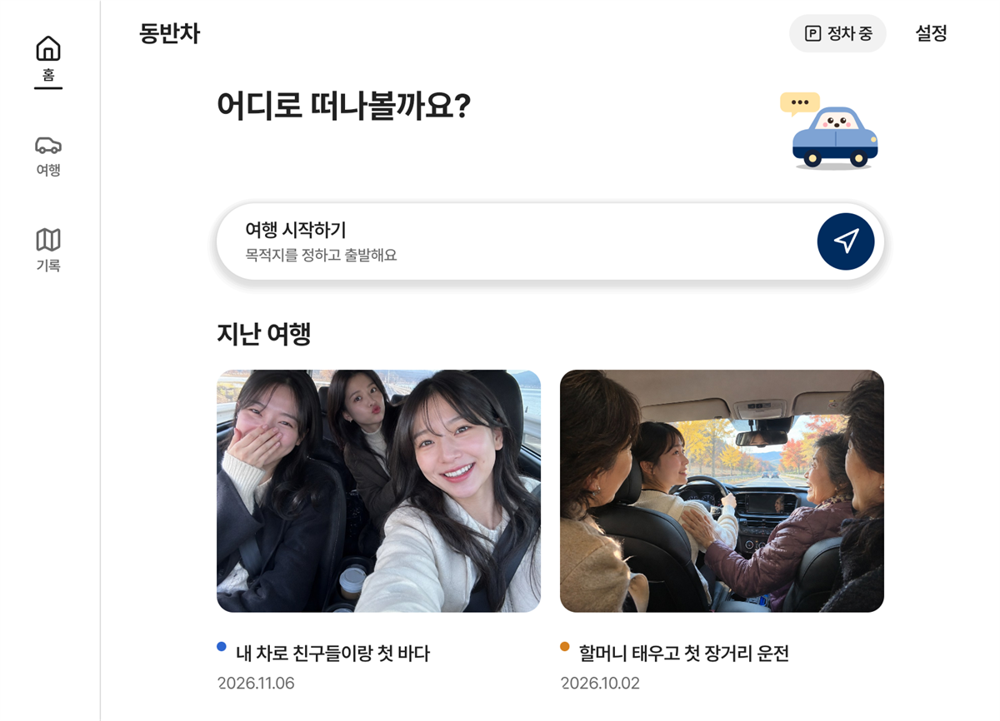
</p>

## 목차

1. [배경](#1-배경)
2. [기능](#2-기능)
3. [프로젝트 구조](#3-프로젝트-구조)
4. [기술적 구현](#4-기술적-구현)
5. [데모 앱 실행 방법과 디버그 앱](#5-데모-앱-실행-방법과-디버그-앱)

---

## 1. 배경

### 가는 길은 어디에도 남지 않습니다

가족, 연인, 친구와 떠나는 여행에서 우리는 생각보다 많은 시간을 '가는 길' 위에서 보냅니다. 몇 시간 동안 같은 차 안에 앉아 평소에 하지 않던 이야기를 하고 함께 웃습니다. 하지만 사진과 영상은 대개 도착한 뒤에 찍힙니다. 그래서 이동하는 시간은 기록에서 빠집니다.

긴 주행에서는 그마저도 오래가지 않습니다. 대화가 끊기면 동승자는 잠들거나 각자 휴대폰을 봅니다. 함께 탔지만 함께하지 못하는 시간이 생깁니다.

### 휴대폰으로는 차 안을 남기기 어렵습니다

지금도 휴대폰으로 찍고 녹음할 수는 있지만, 차 안에서는 잘 맞지 않습니다.

- **운전자는 휴대폰을 들 수 없습니다.** 동승자가 휴대폰을 꺼내는 순간에도 대화의 흐름이 끊깁니다.
- **어렵게 남긴 기록도 다시 꺼내 보지 않습니다.** 몇 시간짜리 녹음 파일이나 흩어진 사진 몇 장에는 언제, 어디서, 누구와의 순간이었는지가 없습니다.

결국 차 안의 시간은 남기기도 어렵고, 남겨도 추억이 되기 어렵습니다.

### 이 일을 가장 잘할 수 있는 곳은 차 안입니다

차는 이미 필요한 것을 모두 갖추고 있습니다. 위치, 기어와 문 열림 같은 차량 상태, 마이크, 탑승자 모두가 함께 보는 화면입니다. 동반차는 누구도 휴대폰을 들지 않고 이 시간을 기록하는 방법을 제안합니다.

- 출발 전에 탑승자 **모두의 동의**를 받습니다.
- 주행 경로와 차 안의 대화를 함께 듣되, **모든 대화를 저장하지 않습니다.** 차 안에서 도는 판정 모델이 다시 듣고 싶을 만한 이야기만 골라 음성과 자막으로 남깁니다.
- 차 안이 오래 조용해지면 **잠든 가족을 깨우지 않는 방식으로** 조심스럽게 말을 겁니다.
- 여행이 끝나면 날짜, 함께한 사람, 달려온 길, 사진, 나눈 이야기를 **한 권의 다이어리**로 정리합니다. 기록이 쌓일수록 지도 위의 길도 늘어납니다.

동반차는 차량 데이터를 '함께 보낸 시간의 기록'이라는 경험으로 바꿉니다. 공모 분야인 패밀리·동승자 케어와 인카 엔터테인먼트에 새로운 가치를 더하는 것이 목표입니다.

| 1차 타깃 | 2차 타깃 |
|---|---|
| 어린 자녀와 나들이, 명절 귀성길처럼 장거리 이동이 잦은 가족 | 함께 여행을 자주 다니는 연인과 친구 |

---

## 2. 기능

> 화면은 모두 Pleos Connect 에뮬레이터(v2.1.0)에서 앱의 2/3 분할 화면을 캡처한 것입니다. 지난 여행 3개는 데모 데이터입니다. 여행 중 대화는 디버그 앱으로 실제 음성 파일을 녹음 입력에 흘려 넣어 기록했습니다.

### ① 여행 시작: 함께 가는 사람과 녹음 동의

홈에서 **여행 시작하기**를 누르고 여행 제목과 함께 가는 사람을 정합니다. 목적지는 차량 내비에서 찍으면 자동으로 들어옵니다. 이어서 녹음 동의 화면에서 두 가지를 따로 정합니다.

- **대화 듣고 기기 안에서 고르기**: 음성과 대화는 차 밖으로 나가지 않습니다.
- **고른 이야기를 AI로 정리하기**: 기기 안에서 고른 이야기의 글만 외부 AI로 보내 제목과 태그를 붙입니다.

첫 항목을 끄면 녹음 없이 출발합니다. 처음 출발할 때는 주행 중 쓸 수 있는 음성 명령을 한 번 안내합니다.

| 여행 설정 | 녹음 동의 | 음성 명령 안내 |
|---|---|---|
| 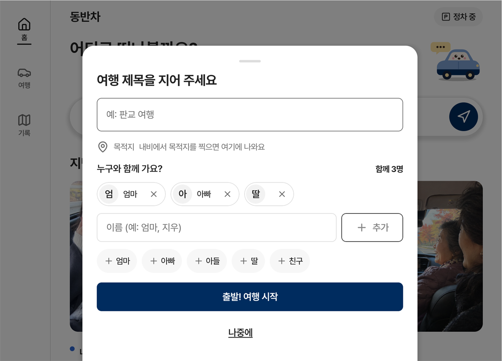 | 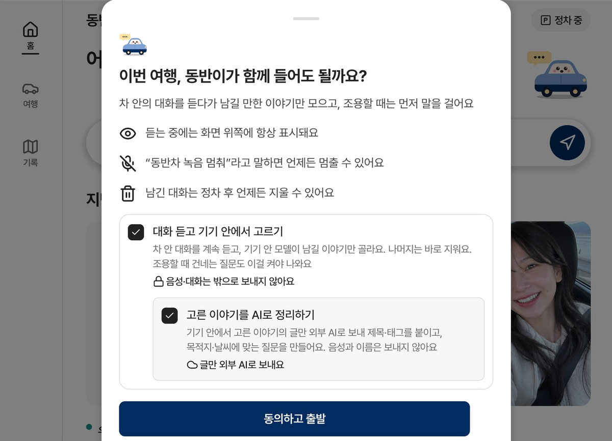 | 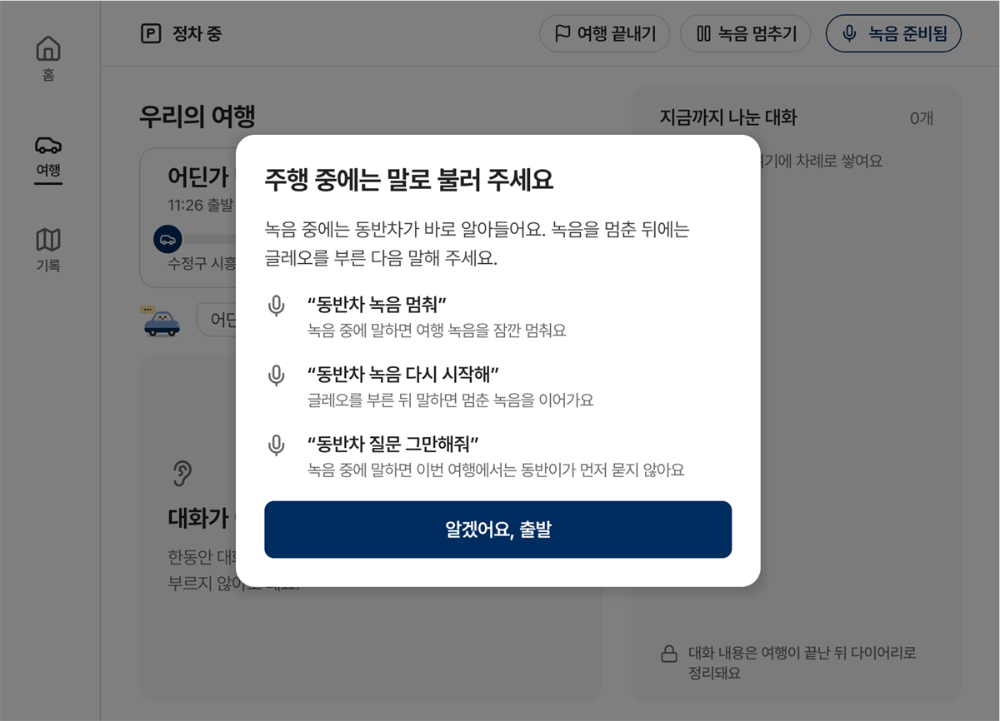 |

### ② 주행 중: 화면은 보기만, 기록은 저절로

주행 중 화면에는 목적지까지의 길 리본, 녹음 상태, 지금까지 저장한 대화만 보입니다. 앱은 대화에 끼어들지 않고 조용히 듣다가, 남길 만한 이야기만 골라 음성 조각으로 저장합니다.

- 녹음 상태(녹음 중, 멈춤, 저장됨)는 화면 위쪽에 항상 보입니다.
- 버튼은 정차 중에만 나옵니다. 주행 중에는 버튼이 사라지고 말로 조작합니다.

| 정차 중 | 주행 중 (대화 3개 저장됨) |
|---|---|
| 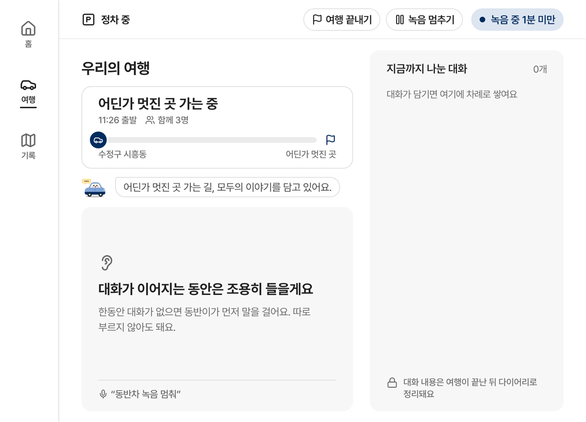 | 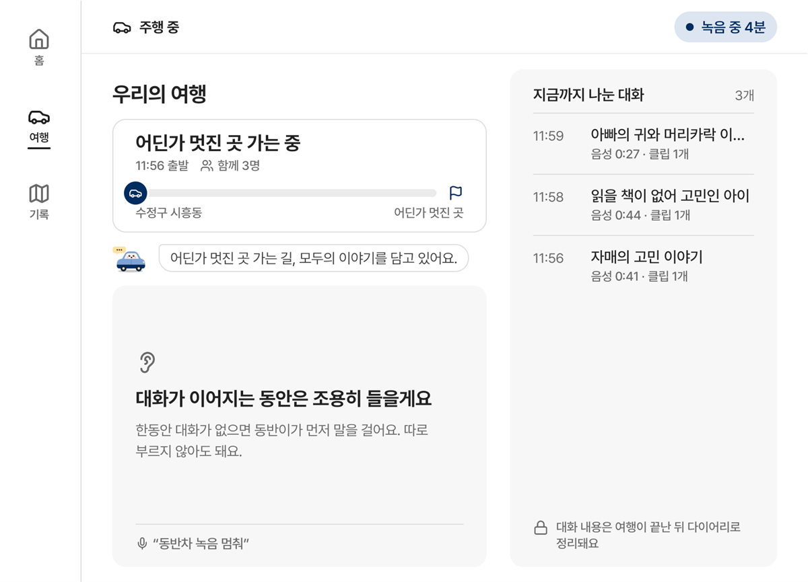 |

### ③ 조용할 때만 건네는 질문

대화가 이어지는 동안에는 끼어들지 않습니다. 대화 내용이 아니라 말소리의 유무와 목적지까지 남은 시간으로 때를 봅니다.

1. 차 안이 오래 조용하면 소리 없이 화면으로만 "혹시 다들 자고 있나요?"를 묻습니다.
2. 반응이 없으면 그 여행에서는 먼저 묻지 않습니다.
3. "아니, 안 자"처럼 말로 답하면 여행지와 동행 관계에 맞는 가벼운 질문을 소리로 읽어 줍니다.

| 잠들었는지 확인 (Q01) | 대화 질문 (Q02) |
|---|---|
| 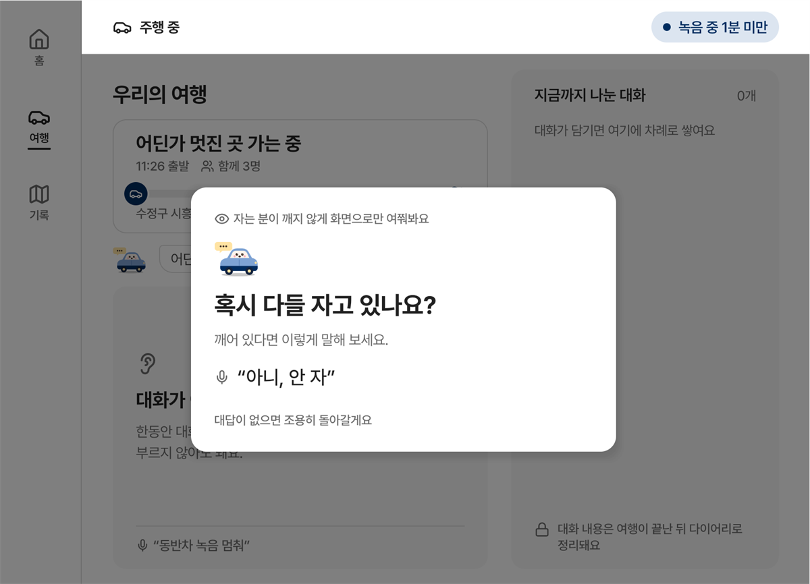 | 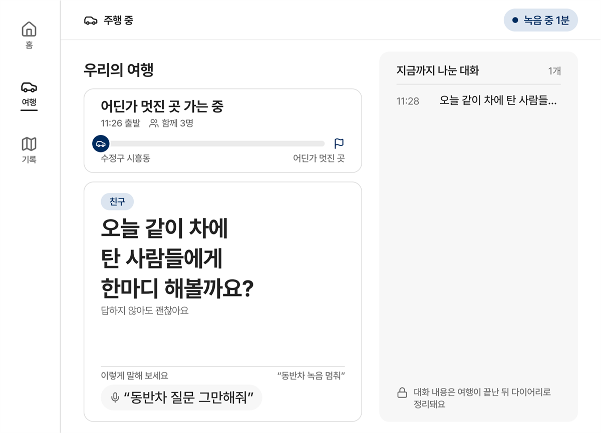 |

### ④ 운전자 안전: 기록은 정차했을 때만

Pleos [운전자 주의 분산 가이드라인](https://document.pleos.ai/docs/pleos-only/vehicle-app-planning-guide/driver-distraction-guideline)에 따라, 화면을 오래 봐야 하는 기능은 정차 중에만 엽니다.

- **다이어리, 기록 지도, 사진은 정차 중에만 열립니다.** 주행 중에 누르면 "이 기록은 안전하게 정차한 뒤 펼쳐볼 수 있어요"(P01)를 안내합니다.
- **정차하면 이어서 엽니다.** 기어가 P가 되면 "이제 펼쳐볼 수 있어요"(P02)로 원래 열려던 화면을 엽니다.
- **설정, 키 입력, 여행 끝내기도 정차 중에만 할 수 있습니다.**
- **주행 중 조작은 음성으로 합니다.** "동반차 녹음 멈춰", "동반차 질문 해줘", "동반차 질문 그만해줘"라고 말합니다.

| 주행 중 기록 열기 (P01) | 정차 후 이어서 열기 (P02) |
|---|---|
| 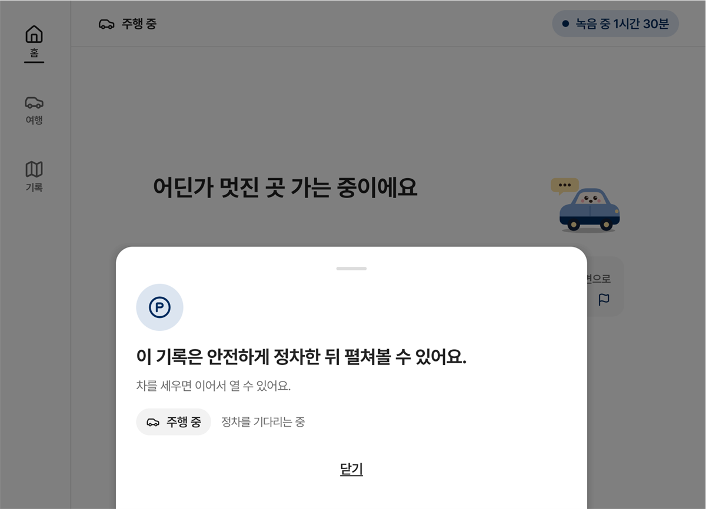 | 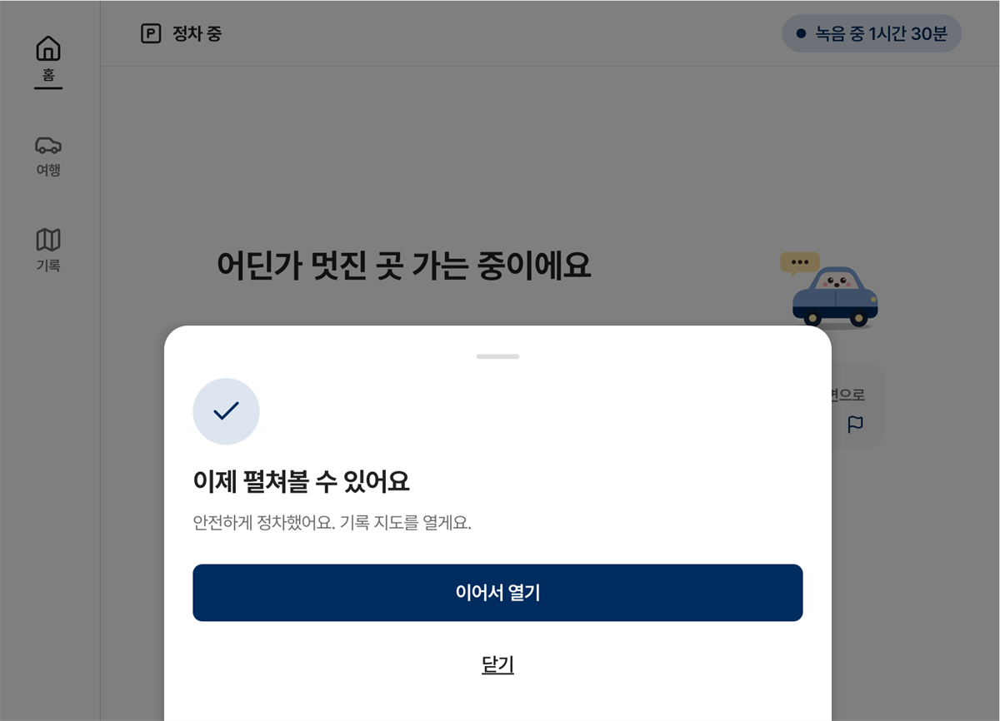 |

### ⑤ Gleo와 함께 쓰는 음성 명령

녹음 중에는 동반차가 마이크를 쓰므로 앱이 직접 명령을 알아듣습니다. 녹음을 멈춘 뒤에는 운전대 음성 버튼이나 "글레오"로 차량 음성 비서 Gleo를 부른 다음 "동반차 녹음 다시 시작해"라고 말합니다. 동반차는 앱 스키마(`assets/schema.json`)로 `PAUSE_TRIP_RECORDING`, `RESUME_TRIP_RECORDING`, `ASK_NEW_QUESTION` 기능을 Gleo에 등록합니다. Gleo 호출어와 기기 명령이 담긴 발화는 기록에서 뺍니다.

<p align="center">
  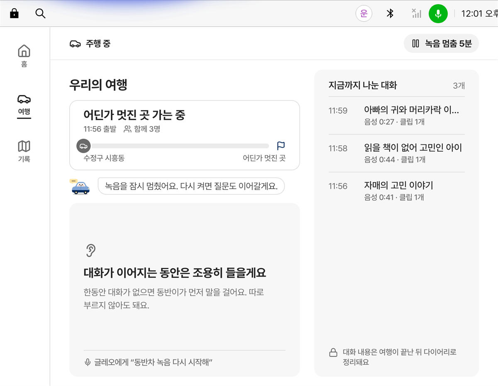
</p>

### ⑥ 도착과 다이어리 생성

차량 내비가 목적지 도착을 알리거나, 목적지 300m 안에서 기어가 P가 되면 여행을 스스로 마칩니다. 도착이 아니라면 **아직 여행 중이에요**로 되돌립니다. 주행 중에는 다이어리를 만들지 않고, 정차한 뒤 녹음 저장, 이야기 정리, 경로와 시간 정리, 다이어리 꾸미기 순서로 진행합니다.

| 도착 | 다이어리 만드는 중 | 완성 |
|---|---|---|
| 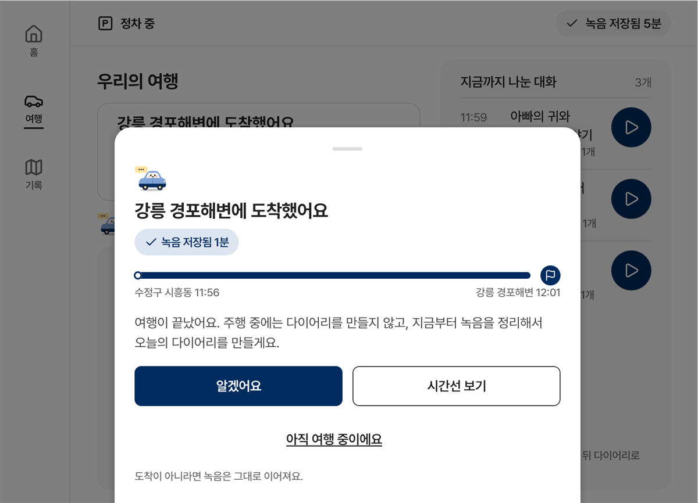 | 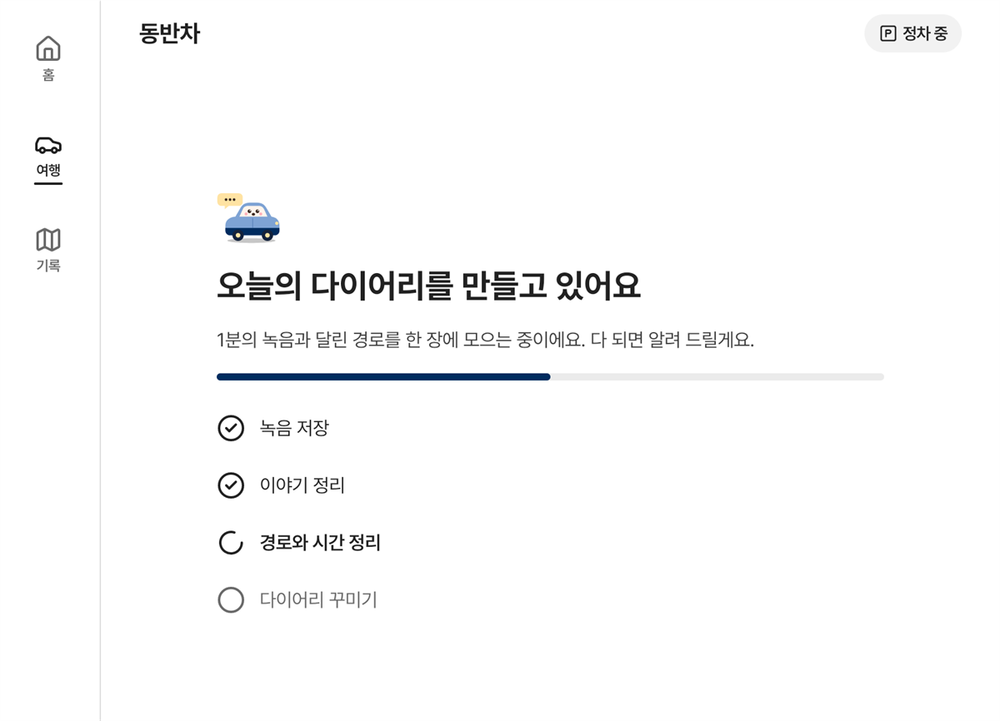 | 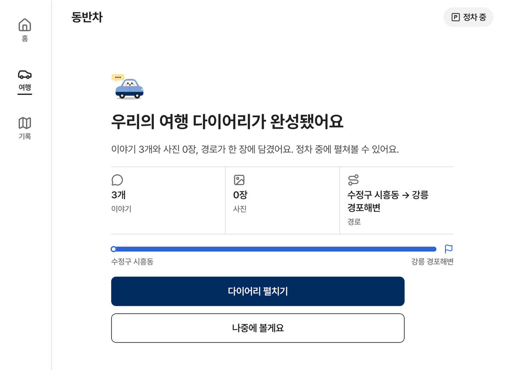 |

### ⑦ 기록 지도와 다이어리

지금까지의 여행은 지도 위에 기록마다 다른 색의 경로로 쌓입니다. 경로나 카드를 누르면 그날의 다이어리가 열립니다.

| 기록 지도 | 경로 고르기 |
|---|---|
| 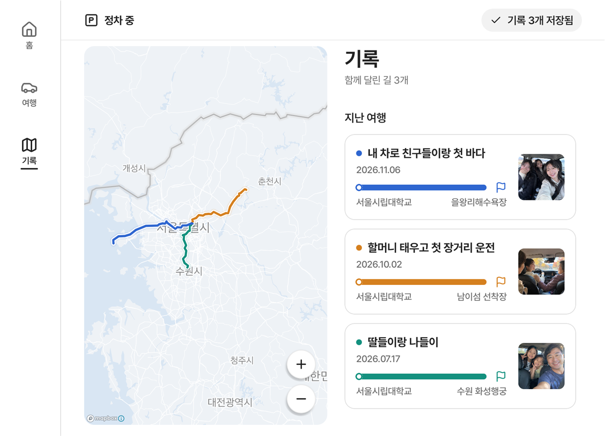 | 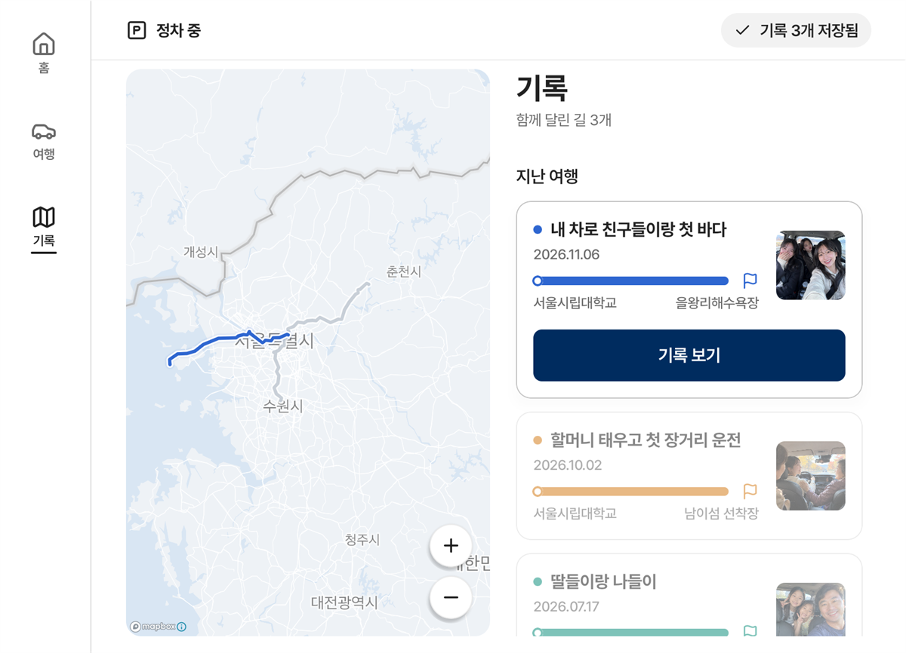 |

다이어리에는 날짜, 제목, 함께한 사람, 실제 주행 경로, 함께 달린 시간, 사진, 나눈 이야기가 한 장에 담깁니다.

- **나눈 이야기**: 이야기마다 제목, 태그, 음성 길이가 붙고 눌러서 다시 듣습니다. 이야기를 고르면 지도와 시간 띠에서 그 자리를 함께 보여 줍니다.
- **지도 핀**: 겹친 핀은 `+N` 배지로 묶이고, 누르면 확대됩니다.
- **사진**: 정방형 썸네일로 보여 줍니다. 더보기를 누르면 비율을 살린 masonry로 펼쳐지고, 누르면 크게 봅니다.

| 다이어리 | 이야기 고르기 |
|---|---|
| 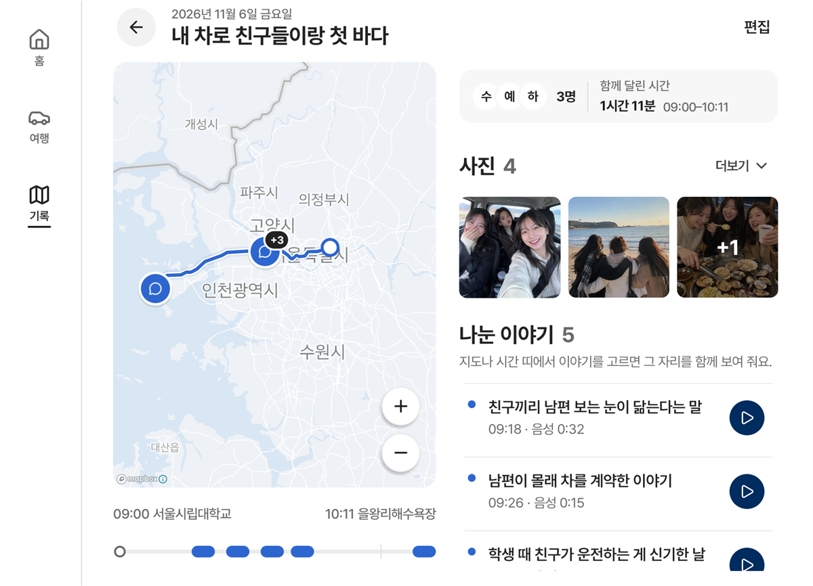 | 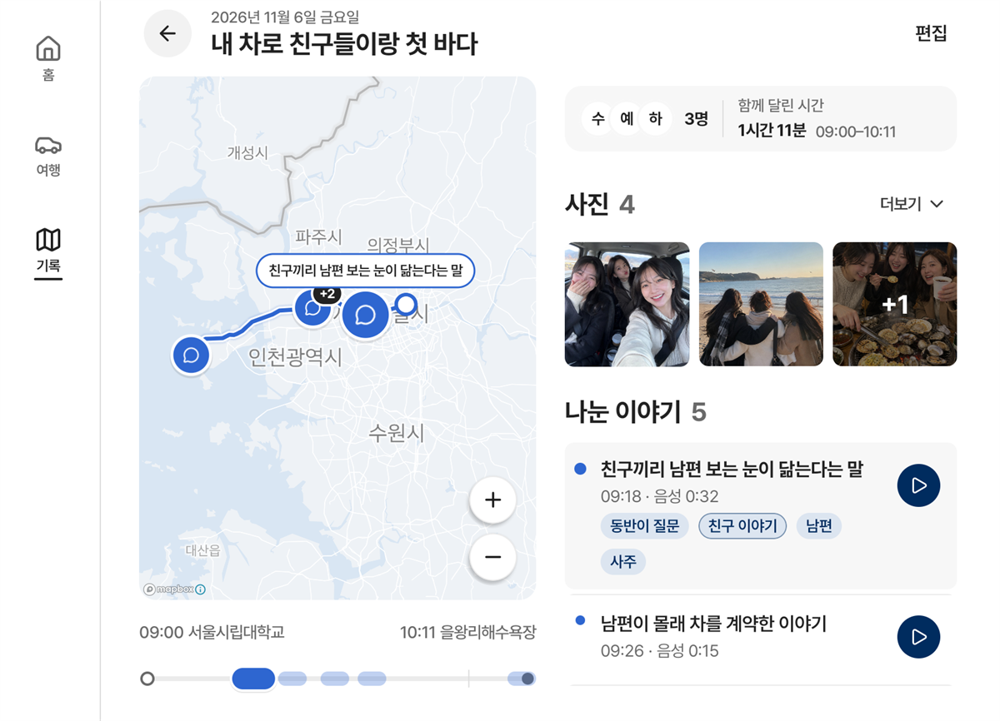 |

| 사진 펼치기 | 사진 크게 보기 |
|---|---|
| 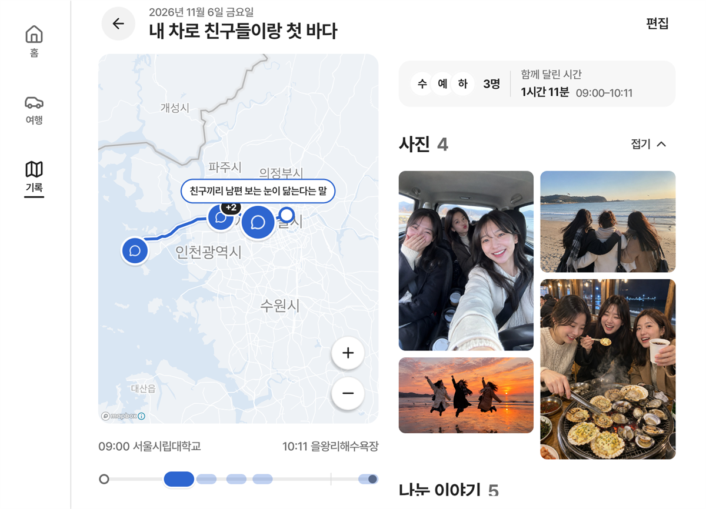 |  |

---

## 3. 프로젝트 구조

```text
drive-diary/
├── app/                      Android 앱 (Kotlin, Jetpack Compose)
│   └── src/
│       ├── main/java/com/dongbantest/app/
│       │   ├── ui/v3/            확정 디자인 화면(홈, 여행, 기록, 다이어리)과 디자인 토큰
│       │   ├── ui/v3connect/     화면과 데이터 연결(NavHost, 상태 변환)
│       │   ├── data/             Room DB, 저장소, 대화 기록 연결(talk), 질문(ask), 데모 데이터(demo)
│       │   ├── vehicle/          Pleos Vehicle SDK, 기어·좌석·문 신호, 주행 제한 감시
│       │   ├── location/         FusedLocation·GPS 위치 기록
│       │   ├── navi/             NaviHelper 목적지·도착 판단
│       │   └── gleo/             Gleo 앱 스키마 수신기, 음성 명령
│       ├── main/assets/          Gleo 앱 스키마, 데모 여행(GPX·음성·사진)
│       └── debug/                디버그 전용 앱 "동반차 디버그"
├── module/talkrec/           대화 기록 라이브러리 (:talkrec, 앱에 함께 빌드)
├── talk-rec/                 판정 모델 제작·STT 실험·설계 문서 (빌드에 들어가지 않음)
├── tools/demo/               데모 음성 자르기·넣기 스크립트
└── docs/                     실행·검증 안내, 화면 연동 문서, README 이미지
```

이름이 비슷한 두 폴더는 역할이 다릅니다.

| 폴더 | 내용 |
|---|---|
| `module/talkrec` | 앱에 들어가는 대화 기록 코드입니다. Gradle에서 `:talkrec`으로 등록되고 `app`이 사용합니다. |
| `talk-rec` | 그 코드에 들어갈 판정 모델, 규칙, 프롬프트를 만들고 측정하는 Python 실험 공간입니다. 결과물(`m1/`, `policy/rules.json`, `prompts/`)만 `module/talkrec/src/main/assets`로 옮깁니다. |

대화 기록 모듈(`:talkrec`) 안은 다음과 같습니다.

| 패키지 | 하는 일 |
|---|---|
| `TalkRec.kt` | 앱이 부르는 입구: `start`, `pause`, `resume`, `stop`, 상태 `StateFlow` |
| `capture/` | 마이크 포그라운드 서비스, Pleos STT 연속 전사, 최근 3분 음성 버퍼 |
| `block/` | 전사 줄을 대화 묶음으로 나눔 (침묵 20초 또는 길이 90초) |
| `policy/` | 기록 거부, 음성 명령 같은 규칙 (`rules.json`) |
| `judge/` | 기기 안 판정 모델(M1, ONNX)로 남길 대화인지 판단 |
| `clip/` | 남길 묶음을 음성 조각(`.m4a`)으로 저장 |
| `summary/` | 동의한 경우 외부 AI로 제목·태그를 붙이고 이어지는 조각을 이야기로 묶음 |
| `ask/` | 조용할 때 건네는 질문: 조용함 판단, 반응 분류, 질문 생성, Pleos TTS |

자세한 내용은 [module/talkrec/README.md](module/talkrec/README.md)와 [talk-rec/README.md](talk-rec/README.md)에 있습니다.

---

## 4. 기술적 구현

### 기술 스택

| 영역 | 사용 기술 |
|---|---|
| 플랫폼 | Pleos Connect (Android Automotive OS), 검증: Pleos Connect v2.1.0 에뮬레이터 (Android 14, API 34) |
| 언어·화면 | Kotlin, Jetpack Compose (최소 API 28) |
| 저장 | Room (여행, 위치, 음성, 사진), 음성 파일은 앱 전용 저장소에만 |
| 차량 | Pleos Vehicle SDK 2.3.2, FusedLocation 1.1.3, NaviHelper 3.0.5, AAOS `CarPropertyManager`, `CarUxRestrictionsManager` |
| 음성 | Pleos SpeechToText 3.3.1 (온디바이스), Pleos TextToSpeech 3.3.1, ONNX Runtime 1.23.2 |
| 지도 | Mapbox Maps SDK 11.34.2 (Pleos 지도 SDK가 없어 사용) |
| 외부 AI (선택) | Cloudflare Workers AI `@cf/google/gemma-4-26b-a4b-it`, 고른 이야기의 제목·태그와 질문 생성 |

### 대화 기록: 모두 듣고, 남길 것만 남깁니다

```text
마이크 ─▶ 3분 음성 버퍼(RAM) ─▶ Pleos STT(기기 안) ─▶ 대화 묶음 ─▶ 규칙 검사 ─▶ M1 판정 ─▶ 음성 조각 저장
                                                                                        └▶ (동의 시) 글만 외부 AI로 제목·태그
```

- **STT**: Pleos SpeechToText를 `ON_DEVICE` 모드(ko-KR)로 쓰고, 마이크 음성을 100ms마다 `sendAudio`로 넘깁니다. 전사는 Pleos 플랫폼 프로세스에서 돌아 앱 밖에서 처리됩니다.
- **묶음**: 마지막 확정 문장 뒤 20초 동안 조용하거나 묶음이 90초가 되면 닫습니다.
- **저장**: 남길 묶음은 버퍼에서 앞 3초, 뒤 2초를 더 잘라 AAC 64kbps `.m4a`로 저장합니다. 나머지 음성은 RAM에서 사라집니다.
- **저장 상한**: 자동 저장은 주행 1시간당 최대 10분입니다.
- **기록 거부**: "이 얘긴 남기지 말자"라고 말하면 그 묶음을 버리고 직전에 저장한 조각까지 지웁니다. 길 안내, 다툼, Gleo 호출과 기기 명령도 남기지 않습니다.
- **밖으로 나가는 것**: 외부 AI 동의를 따로 받은 경우에만 저장한 조각의 **글**을 보냅니다. 음성, 이름, 위치는 보내지 않습니다.

### 온디바이스 판정 모델(M1): 우리 데이터로 학습하고 실제 대화로 검증한 모델

#### 왜 기기 안에서 판정하나요

동반차는 여행 내내 차 안 대화를 듣고, 대화 묶음(최대 90초)이 닫힐 때마다 "이 대화를 남길까"를 정해야 합니다. 이 판정을 외부 LLM에 맡기면 간단해 보이지만, 차 안에서는 세 가지가 걸립니다.

- **프라이버시**: 판정을 하려면 남기지 않을 대화까지 모두 밖으로 보내야 합니다. 가족끼리 나눈 사적인 이야기, 아이의 목소리가 담긴 대화가 차 밖으로 나가는 것은 이 서비스의 약속과 맞지 않습니다.
- **비용**: 몇 시간짜리 여행이면 판정 요청이 수십, 수백 번 쌓입니다. 차량마다, 여행마다 이 비용이 계속 듭니다.
- **속도와 연결**: 터널, 산길, 지방 도로에서는 연결이 끊기거나 느려집니다. 판정이 늦어지면 음성 버퍼(3분)가 지나가 남길 대화를 놓칠 수 있습니다.

그래서 **남길지 말지는 기기 안의 작은 모델이 정하고**, 외부 AI는 사용자가 따로 동의한 경우에만, 이미 남기기로 고른 대화의 **글**에 제목과 태그를 붙일 때만 씁니다. 버려지는 대화는 처음부터 끝까지 차 밖으로 나가지 않습니다.

#### 모델을 만든 과정

차 안 가족 대화 중 다시 듣고 싶은 순간을 고르는 일은, 공개된 모델을 그대로 가져와 풀기 어려운 문제였습니다. 무엇을 남길지에 대한 기준도, Pleos STT가 내놓는 글 모양에 맞춘 학습 데이터도 마땅한 것이 없었습니다. 그래서 기준을 세우는 일부터 시작해 학습 데이터, 파인튜닝, 실제 대화 평가, 경량화, 앱 이식까지 한 단계씩 이어 갔습니다. 한국어 사전학습 인코더(KoELECTRA-small-v3)를 바탕으로, **"남길지 말지"를 판단하는 부분은 우리가 만든 데이터로 새로 학습시켰습니다.**

| ① 기준 정의 | ② 학습 데이터 | ③ 파인튜닝 | ④ 실제 평가 | ⑤ 경량화 | ⑥ 앱 이식 |
|---|---|---|---|---|---|
| 루브릭 직접 작성 | 장면 카드 3,000장 → 대화 2,978개 | 두 출력 헤드 동시 학습 | 사람이 듣고 단 정답 | INT8, 56MB → 15MB | 골든 테스트, 에뮬레이터 |

#### 출발점: 400MB 안에 들어가야 합니다

Pleos 개발자 문서는 앱 하나의 [RAM 400MB 이하, CPU 3% 이하](https://document.pleos.ai/en/docs/pleos-only/vehicle-app-developer-guide/app-runtime-environment-resources-guide/app-performance-platform-identify)를 권장합니다. 판정 모델은 이 예산 안에서 화면, 지도, 음성 버퍼와 함께 돌아야 합니다. 그래서 모델 몫을 **추가 메모리 60MiB 이하**로 먼저 정하고, 후보를 직접 재서 골랐습니다.

| 후보 | 크기 | 묶음당 판정 시간 (PC CPU 1스레드) | 실제 대화 정확도 (초기 20묶음) | 결과 |
|---|---:|---:|---:|---|
| roberta-small | 272MB | 214ms | 68% | 예산 초과로 제외 |
| mmBERT-small | 219MB | 279ms | 73% | 예산 초과로 제외 |
| 글자 n-gram + 로지스틱 회귀 (M0) | 1MB | 1ms | 75% | 기준선으로 함께 학습 |
| **KoELECTRA-small-v3 (M1)** | 56MB → INT8 15MB | 65ms → 25ms | 73% | **파인튜닝 대상** |

큰 인코더가 더 낫다는 근거는 없었습니다. 2020년 이후 나온 한국어 소형 인코더는 대부분 5,000만 파라미터를 넘어, 예산 안의 후보는 사실상 KoELECTRA-small 계열(약 1,400만 파라미터)뿐이었습니다.

#### ① 기준 정의: 무엇을 남길지 직접 정했습니다

[라벨 기준(루브릭)](talk-rec/model-create/rubric.md)을 직접 썼습니다. 대상은 **아이와 가족이 함께 탄 차 안 대화**입니다. 이야기가 오갔거나 다시 듣고 싶은 한마디가 있으면 **남길 것**, 길 찾기·주차·주유 같은 용무, 형제 실랑이, 업무 통화는 **없음**입니다. 사람끼리도 "이야기"와 "한마디"의 경계에서는 판단이 갈려서, 주 판정은 남길 것/없음 이진으로 두고 종류는 참고 출력으로 내도록 했습니다.

#### ② 학습 데이터: 정답이 먼저 정해진 합성 대화 2,978개

편집하지 않은 차 안 영상은 드물고, LLM에게 라벨을 맡기면 사람 판정과 35개 중 16개만 일치했습니다. 그래서 순서를 뒤집었습니다. **정답을 먼저 정한 장면 카드를 만들고, 그 장면에 맞는 대사를 쓰게 했습니다.**

- **장면 카드 3,000장**: 화제 360개, 이동 상황 24개, 말투 12개, 가족 구성과 아이 나이를 섞었습니다. 카드의 30%(450쌍)는 같은 가족, 같은 화제에서 정답만 다른 **대립쌍**으로 만들어, 화제가 아니라 대화 자체를 보게 했습니다.
- **대사 생성**: LLM(Gemini)은 카드에 맞는 대사만 씁니다. 정답은 카드가 정하므로 LLM의 판단이 라벨에 섞이지 않습니다.
- **Pleos STT 모양으로 망가뜨리기**: 에뮬레이터에서 실제 차 안 음성 25개를 Pleos STT로 받아 적어, 줄 길이(중앙값 13자), 줄 수(묶음당 약 21줄), 띄어쓰기·받아쓰기 오류 모양을 측정했습니다. 깨끗한 대사를 이 모양대로 바꿔, 학습 글이 앱에 실제로 들어오는 글과 같아지게 했습니다.
- **지름길 제거**: 처음 만든 데이터에서는 "없음" 대화가 짧아, 글 내용 없이 길이만 보고도 84%를 맞혔습니다. 이렇게 학습한 모델은 실제 "없음" 8개 중 0–1개만 걸렀습니다. 라벨마다 길이 분포를 같게 다시 만들고, 이 **지름길 검사를 학습 전 관문**으로 두었습니다.
- **사람 검토**: 생성한 대화를 사람이 직접 읽어, 33개 중 29개가 실제 같고 의도한 정답과 맞는 것을 확인했습니다.

#### ③ 파인튜닝: 두 출력을 함께 학습

KoELECTRA-small-v3 인코더 위에 출력 헤드 두 개를 붙여 학습했습니다.

| 항목 | 값 |
|---|---|
| 출력 | `keep` 남길 확률(sigmoid), `kind` 종류 3가지(없음·이야기·한마디) |
| 손실 | BCE(keep) + 0.2 × CE(kind) |
| 학습 | 3 epoch, 학습률 3e-5, 최대 256토큰, RTX 5060 Ti |
| 비교 실험 | 모델 2종(M0, M1) × 데이터 400·1,000·2,978개 × 시드 3개 = 18번 학습 |
| 원칙 | 실제 평가 데이터로 하이퍼파라미터나 데이터 규모를 고르지 않음. 같은 시드로 다시 학습해 가중치까지 같은지 확인 |

#### ④ 평가: 사람이 직접 듣고 판정한 실제 차 안 대화

합성 데이터 점수는 믿지 않았습니다. 초기 시험에서 합성 평가는 91–100%였지만 실제 대화는 68–75%였습니다. 그래서 **실제 차 안 영상 13개를 Pleos STT로 받아 적어 76개 묶음으로 나누고, 사람이 음성을 직접 들으며 정답을 달았습니다.** 주 수치는 아이와 가족이 탄 37묶음(남길 것 25, 없음 12)에서 냅니다.

| 모델 | 남길 대화 재현율 | 없음 걸러내기 | 정확도 | AUROC |
|---|---:|---:|---:|---:|
| 모두 남기기 | 1.00 | 0.00 | 0.68 | 0.50 |
| M0 (n-gram 기준선) | 0.92 | 0.17 | 0.68 | 0.52 |
| **M1 (탑재 모델)** | **0.96** | **0.58** | **0.84** | **0.79** |

- M0는 사실상 "모두 남기기"와 같은 수준이었습니다. M1은 남길 대화 25개 중 24개를 지키면서 없음 대화의 절반 이상을 걸렀습니다.
- 합성 점수와 실제 점수의 차이는 M1이 0.4%p, M0가 20%p였습니다. Pleos STT 모양으로 만든 학습 데이터가 실제 입력에서도 통했다는 뜻입니다.
- 판정이 애매하다고 표시한 묶음을 빼면 M1의 정확도는 0.92입니다.
- 아쉬운 점도 그대로 적습니다. 없음 걸러내기 목표 0.60에는 조금 못 미쳤습니다(0.58).

**문턱**: 남길 이야기를 놓치는 쪽이 더 아프기 때문에, "재현율 0.85 이상을 지키면서 없음을 가장 많이 거르는 값"이라는 규칙으로 문턱 **0.957**을 골랐습니다.

#### ⑤ 경량화: INT8로 줄이고, 판정이 같은지 확인

ONNX(opset 17)로 내보낸 뒤 가중치와 임베딩까지 INT8 동적 양자화했습니다.

| | FP32 | **INT8 (탑재)** |
|---|---:|---:|
| 모델 파일 | 56.45MB | **14.73MB** |
| 실행 메모리 증가 (PC 측정 RSS) | 82.5MB | **38.4MB** |
| 묶음당 판정 시간 (PC CPU 1스레드, 토큰화 포함) | 57.5ms | **25.2ms** |
| 실제 평가 77묶음 판정 | 기준 | **77개 모두 같음** |

양자화하면 확률값은 조금 달라지므로, 검증은 확률이 아니라 **남길지 말지 판정이 같은지**로 했습니다.

#### ⑥ 앱 이식 검증: Python과 앱이 같은 답을 내는지

- **토크나이저 직접 이식**: 학습 때 쓴 WordPiece 토크나이저를 Kotlin으로 옮기고, ONNX Runtime Android(CPU 1스레드)로 돌립니다.
- **골든 테스트**: 직접 만든 가족 대화 20개에 대해 Python이 만든 토큰 id, 마스크, 남길 확률, 판정을 앱 코드가 그대로 내는지 단위 테스트로 확인합니다([`ConversationJudgeGoldenTest`](module/talkrec/src/test/java/com/drivediary/talkrec/judge/ConversationJudgeGoldenTest.kt)).
- **에뮬레이터 실동작**: 실제 대화 음성을 녹음 입력으로 넣어 Pleos STT 전사, M1 판정, 음성 조각 저장까지 앱 안에서 이어지는 것을 확인했습니다. 가족 대화 묶음은 유지 확률 97–98%로 저장됐습니다([디버그 앱 화면](#디버그-앱-동반차-디버그)).
- 판정은 묶음이 닫힐 때 한 번만 합니다. 모델을 읽지 못하거나 메모리가 부족하면 규칙 검사를 통과한 묶음을 저장 후보로 보고 시간당 상한으로만 거릅니다.

설계와 실험 기록은 [설계 문서](talk-rec/model-create/DESIGN.md)와 [작업별 기록](talk-rec/docs/model-create)(T45 Pleos 모양 합성, T47 지름길 제거, T53 대량 생성, T55 학습·평가, T58 양자화)에 있습니다.

### 리소스 사용량: Pleos 권장 기준 안에서

동반차 앱 프로세스만 측정했습니다. 디버그 앱 화면은 닫았고, Pleos STT 서비스는 플랫폼 프로세스라 포함하지 않았습니다.

**측정 조건**

| 항목 | 값 |
|---|---|
| 에뮬레이터 | Pleos Connect v2.1.0 에뮬레이터, x86_64 4코어 |
| 빌드 | debug 빌드 (release보다 무거움) |
| 앱 상태 | 여행 녹음 중, 기어 D(주행 중 화면) |
| 입력 | 실제 대화 음성 파일을 녹음 입력으로 넣어 STT, 판정, 저장이 실제로 돈 상태 |
| 메모리(PSS) | `dumpsys meminfo`, 5초 간격 34회 |
| CPU | `/proc/<pid>/stat`의 CPU 시간을 4코어 전체 대비로 계산 |

**결과**

| 항목 | 결과 | Pleos 권장 |
|---|---|---|
| 메모리 (PSS) | 평균 **213MB**, 최대 **232MB** | 400MB 이하 |
| CPU | 평균 **2.9%** (측정 도구 부하 없이 90초), 3분 측정 중 최대 5.6% | 3% 이하 |

메모리와 CPU를 줄이려고 다음과 같이 만들었습니다.

- 판정 모델을 INT8로 줄였습니다.
- 음성 버퍼는 크기를 정한 3분 순환 버퍼를 다시 씁니다.
- 판정은 묶음마다 한 번만 합니다.
- 기록 지도의 경로는 백그라운드에서 단순화합니다.
- 고른 경로는 지도 레이어 속성만 바꿔 다시 그리지 않습니다.
- 사진은 썸네일 크기로 줄여 읽고 캐시합니다.

초기 검증 앱에서는 합성 음성을 20분 동안 이어 넣는 시험도 했습니다. 발화 80건을 오류 없이 모두 글로 옮겼고, 발화가 끝난 뒤 저장 판정까지 95%가 1.72초 안에 끝났습니다. 이때 PSS는 최대 54.8MiB였고, 사용한 모델은 경량 분류기였습니다. 자세한 내용은 [STT 시험 기록](talk-rec/test/stt/feature2-mixed.md)에 있습니다.

### 주행 안전과 차량 연동

| 기능 | 구현 |
|---|---|
| 주행 중 제한 | AAOS `CarUxRestrictionsManager`가 "주의 분산 제한 필요"를 알리면 주행 중으로 보고 보기 전용 화면만 엽니다. |
| 정차 판단 | 기어 P가 2분 넘게 유지되거나, P 상태에서 운전석이 비거나 안전벨트가 풀리거나 문이 열리면 정차입니다. 신호 대기처럼 P가 아닌 정지는 정차로 보지 않습니다. 차량 신호가 없으면 반경 30m 안에 3분 이상 머무를 때 정차로 봅니다. |
| 도착 판단 | NaviHelper 도착 신호, 또는 목적지 300m 안에서 기어 P일 때입니다. "아직 여행 중이에요"를 누르면 목적지에서 1km를 벗어나기 전까지 다시 끝내지 않습니다. |
| 위치·거리 | FusedLocation으로 3초마다 기록하고, 쓸 수 없으면 GPS로 바꿉니다. 오차 30m 초과, 5m 미만 이동, 초속 70m 초과는 거릅니다. |
| 차량 데이터 | Vehicle SDK는 차대번호, 누적 주행거리, 좌석·안전벨트·문을 읽기만 합니다. 차량 제어 API는 쓰지 않습니다. 연결에 실패하면 모의 데이터로 바꿔 나머지 기능은 그대로 돕니다. |
| 화면 분할 | Pleos 화면 분할(1/3·2/3·전체)에 맞춰 Compact·Expanded·Full 레이아웃이 폭에 따라 바뀝니다. 내비와 나란히 띄워 둘 수 있습니다. |

---

## 5. 데모 앱 실행 방법과 디버그 앱

### 실행

Android SDK와 Pleos Connect 에뮬레이터(또는 Android 기기)가 필요합니다.

```bash
./gradlew installDebug
```

- Pleos 에뮬레이터에서는 앱이 **사용자 10**에서 돕니다.
- 처음 실행하면 공모전 데모 여행 3개(경로, 음성, 사진 포함)가 기록에 자동으로 들어갑니다.
- 권한, 차량 연결 확인 절차는 [Android 실행·검증 안내](docs/android-mvp.md)에 있습니다.
- 일반 Android 기기에서는 차량 정보가 모의 데이터로 표시됩니다.

#### 키 넣기 (선택)

| 키 | 없을 때 | 넣는 곳 |
|---|---|---|
| Mapbox 공개 토큰 (`pk.`) | 지도 자리에 안내 문구만 나옵니다. | 디버그 앱 **지도 설정**, 또는 `local.properties`에 `MAPBOX_ACCESS_TOKEN=pk.…` 한 줄을 넣고 빌드 |
| Cloudflare 계정 ID와 API 토큰 | 대화는 기록되지만 제목·태그가 붙지 않고, 질문은 앱 안 목록에서 고릅니다. | 디버그 앱 **대화 요약 설정**에서 저장 후 **연결 시험**, 또는 `local.properties`에 `CLOUDFLARE_ACCOUNT_ID=…`, `CLOUDFLARE_API_TOKEN=…` 두 줄을 넣고 빌드 (빌드 때 읽어 두었다가, 기기에 저장된 키가 없을 때만 기본값으로 씁니다) |

- 키는 Android Keystore로 암호화해 기기 안에만 둡니다. 화면에는 끝 4자리만 보입니다.
- 키는 정차 중에만 바꿀 수 있습니다.
- `local.properties`는 Git에 올라가지 않습니다. 키를 코드나 이슈에 붙여 넣지 마세요.

#### 에뮬레이터 마이크

- 에뮬레이터는 시작할 때마다 PC 마이크 사용이 꺼집니다. `powershell -ExecutionPolicy Bypass -File tools/emulator/start-pleos.ps1`로 시작하면 마이크 사용을 켜 줍니다.
- `powershell -ExecutionPolicy Bypass -File tools/emulator/start-pleos.ps1 -CheckMic`은 에뮬레이터의 오디오 입력이 고장 났는지 알려 줍니다. 고장 났다면 에뮬레이터를 다시 시작합니다.
- 디버그 빌드는 녹음을 시작하고 5초 동안 마이크에 소리가 한 번도 잡히지 않으면 화면 아래에 안내를 띄웁니다. 소리가 한 번 잡히면 그 뒤로는 띄우지 않습니다.

### 디버그 앱 (동반차 디버그)

debug 빌드를 설치하면 런처에 **동반차 디버그** 아이콘이 따로 생깁니다. 차량 없이 에뮬레이터에서 주행, 음성, Gleo를 시험하는 도구이며, release 빌드에는 들어가지 않습니다.

| 디버그 앱 | 실제 음성 넣기: 실시간 전사 | 실제 음성 넣기: 저장 판정과 AI 요약 |
|---|---|---|
| 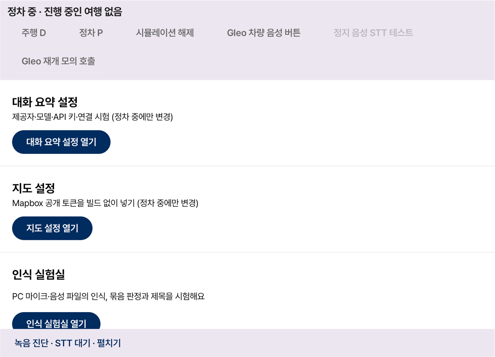 | 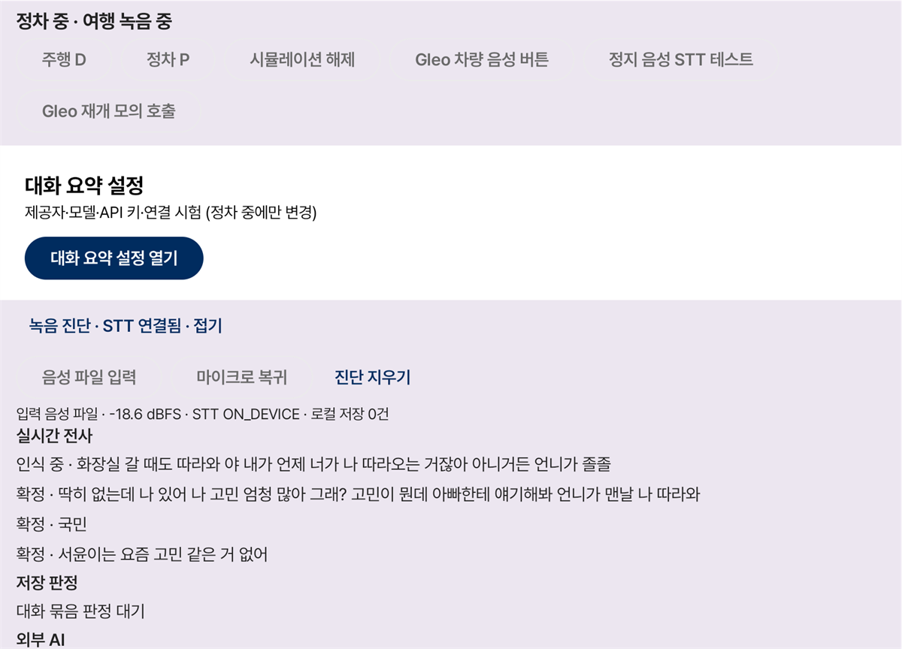 | 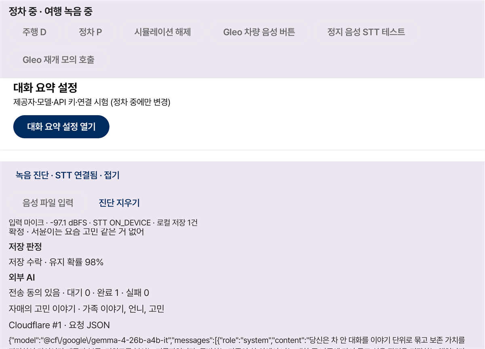 |

| 위치 | 기능 | 하는 일 |
|---|---|---|
| 위쪽 고정 줄 | 주행 D / 정차 P / 시뮬레이션 해제 | 기어를 흉내 냅니다. D면 주행 중 제한이 걸립니다. |
| 위쪽 고정 줄 | Gleo 차량 음성 버튼 | 운전대 음성 버튼 입력을 보냅니다. PC에서 `python module/talkrec/tools/gleo-voice-button.py`가 실행 중이어야 합니다. |
| 위쪽 고정 줄 | Gleo 재개 모의 호출 | Gleo가 보내는 녹음 재개 동작을 흉내 냅니다. |
| 아래쪽 녹음 진단 | 음성 파일 입력 / 마이크로 복귀 | 앱 `files/lab` 폴더의 음성 파일을 마이크 대신 여행 녹음에 넣습니다. 실시간 전사, 저장 판정, 외부 AI 요청 상태를 봅니다. |
| 카탈로그 | 대화 요약 설정 | 제공자, 모델, Cloudflare 키, 연결 시험 |
| 카탈로그 | 지도 설정 | Mapbox 공개 토큰 넣기·지우기 |
| 카탈로그 | 인식 실험실 | 여행 없이 음성 파일로 인식, 묶음 판정, 제목 만들기를 시험합니다. |
| 카탈로그 | 질문 실험실 | 위치로 질문 만들기, Pleos TTS 읽기, 조용함·반응 흉내 |
| 카탈로그 | 예시 여행 | 데모 여행 3개를 넣거나 지웁니다. |

#### adb로 흉내 내기

에뮬레이터 앱은 사용자 10에서 돌기 때문에 모든 명령에 `--user 10`을 붙입니다.

```bash
# 기어 D / P
adb shell am broadcast --user 10 -a com.dongbantest.app.DEBUG_GEAR -n com.dongbantest.app/.vehicle.DebugGearReceiver --es gear D
# 내비 도착
adb shell am broadcast --user 10 -a com.dongbantest.app.DEBUG_ARRIVAL -n com.dongbantest.app/.navi.DebugArrivalReceiver --es name "강릉 경포해변"
# 조용할 때 확인(Q01) 띄우기, 바로 질문(Q02)
adb shell am broadcast --user 10 -a com.dongbantest.app.debug.ASK_FORCE_QUIET -n com.dongbantest.app/.debug.DebugQuestionReceiver
adb shell am broadcast --user 10 -a com.dongbantest.app.debug.ASK_FORCE_QUESTION -n com.dongbantest.app/.debug.DebugQuestionReceiver
# "동반차 녹음 멈춰" 음성 명령 흉내
adb shell am broadcast --user 10 -a com.dongbantest.app.debug.ASK_VOICE -n com.dongbantest.app/.debug.DebugQuestionReceiver --es cmd pause
# 운전대 음성 버튼(Gleo 호출)
adb shell cmd car_service inject-key 231
```

- 로그는 Logcat 태그 `TalkRec`(대화 기록)과 `QuestionCoordinator`(질문)에서 봅니다. 대화 글은 로그에 남기지 않습니다.
- 질문 흐름의 다른 명령은 [디버그 수신기](app/src/debug/java/com/dongbantest/app/debug/DebugQuestionReceiver.kt)를 보세요.

---

## 협업 안내

작업은 [작업 이슈 템플릿](.github/ISSUE_TEMPLATE/task.md)으로, 버그는 [버그 신고 템플릿](.github/ISSUE_TEMPLATE/bug_report.md)으로 등록합니다. 저장소 파일을 바꿀 때는 작업 브랜치에서 [PR 템플릿](.github/pull_request_template.md)에 따라 PR을 엽니다. 자세한 안내는 [CONTRIBUTING.md](CONTRIBUTING.md)에 있습니다.
