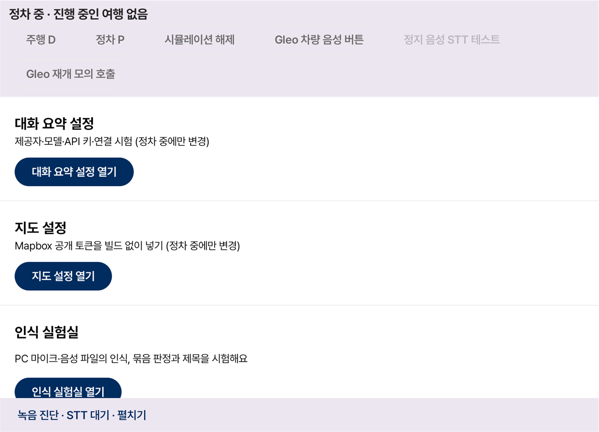
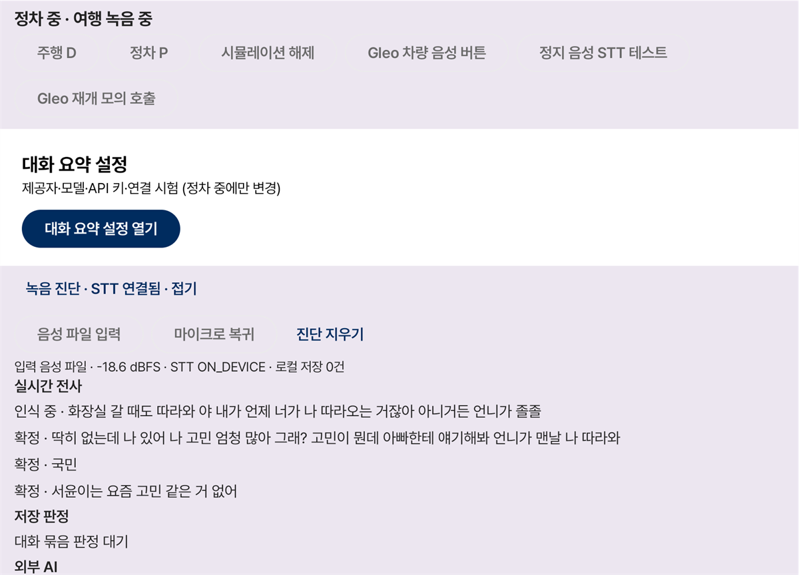
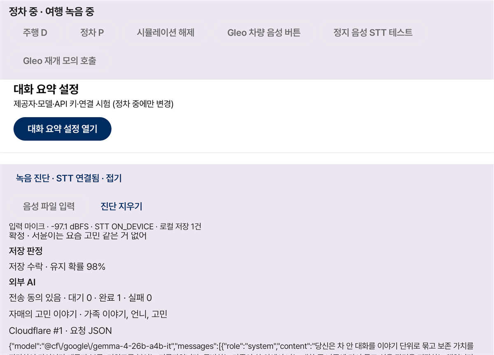

[← README로 돌아가기](https://github.com/hyundai-app-devchallenge/drive-diary#5-데모-앱-실행-방법과-디버그-앱)

# 디버그 앱 (동반차 디버그)

debug 빌드를 설치하면 런처에 **동반차 디버그** 아이콘이 따로 생깁니다. 차량 없이 에뮬레이터에서 주행, 음성, Gleo를 시험하는 도구이며, release 빌드에는 들어가지 않습니다.

| 디버그 앱 | 실제 음성 넣기: 실시간 전사 | 실제 음성 넣기: 저장 판정과 AI 요약 |
|---|---|---|
|  |  |  |

| 위치 | 기능 | 하는 일 |
|---|---|---|
| 위쪽 고정 줄 | 주행 D / 정차 P / 시뮬레이션 해제 | 기어를 흉내 냅니다. D면 주행 중 제한이 걸립니다. |
| 위쪽 고정 줄 | Gleo 차량 음성 버튼 | 운전대 음성 버튼 입력을 보냅니다. PC에서 `python module/talkrec/tools/gleo-voice-button.py`가 실행 중이어야 합니다. |
| 위쪽 고정 줄 | Gleo 재개 모의 호출 | Gleo가 보내는 녹음 재개 동작을 흉내 냅니다. |
| 아래쪽 녹음 진단 | 음성 파일 입력 / 마이크로 복귀 | 앱 `files/lab` 폴더의 음성 파일을 마이크 대신 여행 녹음에 넣습니다. 실시간 전사, 저장 판정, 외부 AI 요청 상태를 봅니다. |
| 카탈로그 | 대화 요약 설정 | 제공자, 모델, Cloudflare 키, 연결 시험 |
| 카탈로그 | 지도 설정 | Mapbox 공개 토큰 넣기·지우기 |
| 카탈로그 | 인식 실험실 | 여행 없이 음성 파일로 인식, 묶음 판정, 제목 만들기를 시험합니다. |
| 카탈로그 | 질문 실험실 | 위치로 질문 만들기, Pleos TTS 읽기, 조용함·반응 흉내 |
| 카탈로그 | 예시 여행 | 데모 여행 3개를 넣거나 지웁니다. |

## adb로 흉내 내기

에뮬레이터 앱은 사용자 10에서 돌기 때문에 모든 명령에 `--user 10`을 붙입니다.

```bash
# 기어 D / P
adb shell am broadcast --user 10 -a com.dongbantest.app.DEBUG_GEAR -n com.dongbantest.app/.vehicle.DebugGearReceiver --es gear D
# 내비 도착
adb shell am broadcast --user 10 -a com.dongbantest.app.DEBUG_ARRIVAL -n com.dongbantest.app/.navi.DebugArrivalReceiver --es name "강릉 경포해변"
# 조용할 때 확인(Q01) 띄우기, 바로 질문(Q02)
adb shell am broadcast --user 10 -a com.dongbantest.app.debug.ASK_FORCE_QUIET -n com.dongbantest.app/.debug.DebugQuestionReceiver
adb shell am broadcast --user 10 -a com.dongbantest.app.debug.ASK_FORCE_QUESTION -n com.dongbantest.app/.debug.DebugQuestionReceiver
# "동반차 녹음 멈춰" 음성 명령 흉내
adb shell am broadcast --user 10 -a com.dongbantest.app.debug.ASK_VOICE -n com.dongbantest.app/.debug.DebugQuestionReceiver --es cmd pause
# 운전대 음성 버튼(Gleo 호출)
adb shell cmd car_service inject-key 231
```

- 로그는 Logcat 태그 `TalkRec`(대화 기록)과 `QuestionCoordinator`(질문)에서 봅니다. 대화 글은 로그에 남기지 않습니다.
- 질문 흐름의 다른 명령은 [디버그 수신기](https://github.com/hyundai-app-devchallenge/drive-diary/blob/main/app/src/debug/java/com/dongbantest/app/debug/DebugQuestionReceiver.kt)를 보세요.

---

← 이전: [온디바이스 판정 모델(M1)](m1-model.md) | 다음: [협업 안내](https://github.com/hyundai-app-devchallenge/drive-diary#협업-안내) →
