[← README로 돌아가기](https://github.com/hyundai-app-devchallenge/drive-diary#2-기능)

# 2. 기능

> 화면은 모두 Pleos Connect 에뮬레이터(v2.1.0)에서 앱의 2/3 분할 화면을 캡처한 것입니다. 지난 여행 3개는 데모 데이터입니다. 여행 중 대화는 디버그 앱으로 실제 음성 파일을 녹음 입력에 흘려 넣어 기록했습니다.

## ① 여행 시작: 함께 가는 사람과 녹음 동의

홈에서 **여행 시작하기**를 누르고 여행 제목과 함께 가는 사람을 정합니다. 목적지는 차량 내비에서 찍으면 자동으로 들어옵니다. 이어서 녹음 동의 화면에서 두 가지를 따로 정합니다.

- **대화 듣고 기기 안에서 고르기**: 음성과 대화는 차 밖으로 나가지 않습니다.
- **고른 이야기를 AI로 정리하기**: 기기 안에서 고른 이야기의 글만 외부 AI로 보내 제목과 태그를 붙입니다.

첫 항목을 끄면 녹음 없이 출발합니다. 처음 출발할 때는 주행 중 쓸 수 있는 음성 명령을 한 번 안내합니다.

| 여행 설정 | 녹음 동의 | 음성 명령 안내 |
|---|---|---|
| 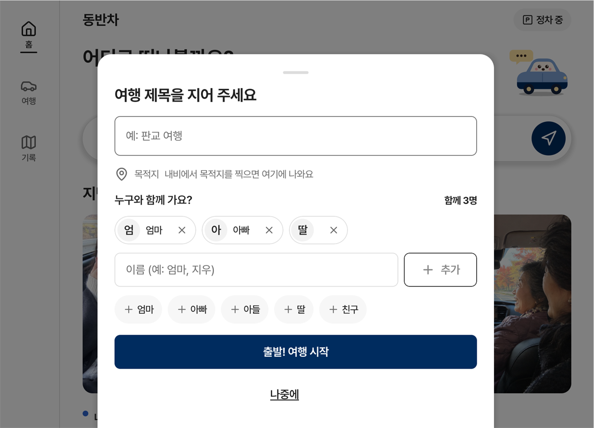 | 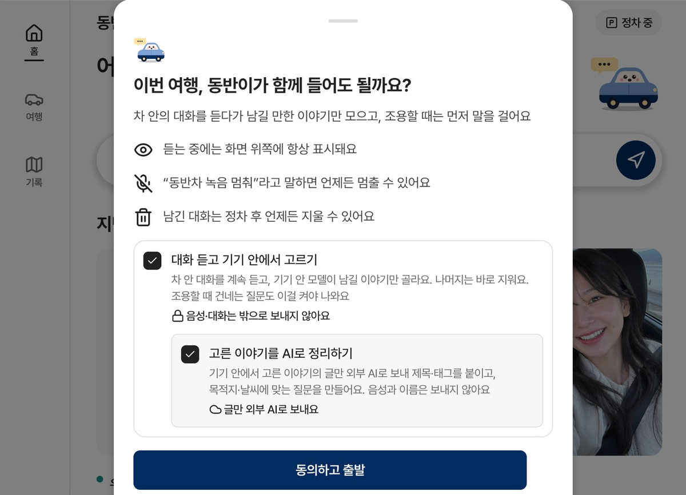 | 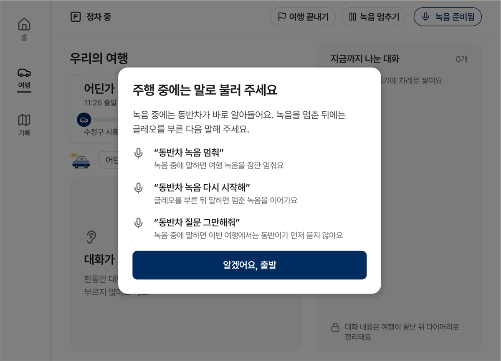 |

## ② 주행 중: 화면은 보기만, 기록은 저절로

주행 중 화면에는 목적지까지의 길 리본, 녹음 상태, 지금까지 저장한 대화만 보입니다. 앱은 대화에 끼어들지 않고 조용히 듣다가, 남길 만한 이야기만 골라 음성 조각으로 저장합니다.

- 녹음 상태(녹음 중, 멈춤, 저장됨)는 화면 위쪽에 항상 보입니다.
- 버튼은 정차 중에만 나옵니다. 주행 중에는 버튼이 사라지고 말로 조작합니다.

| 정차 중 | 주행 중 (대화 3개 저장됨) |
|---|---|
| 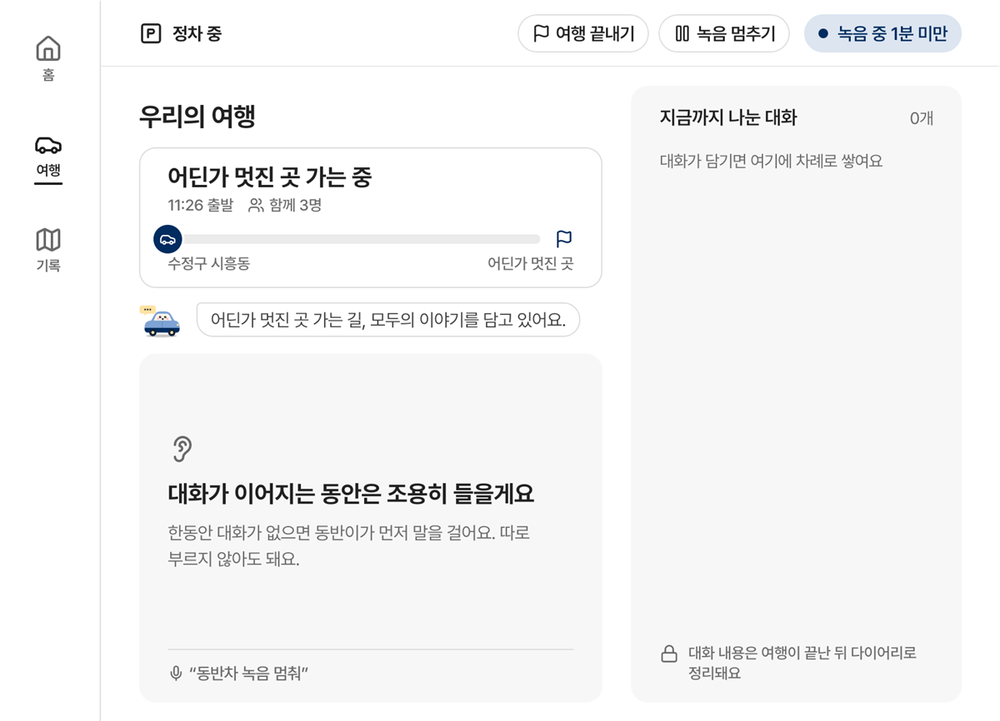 | 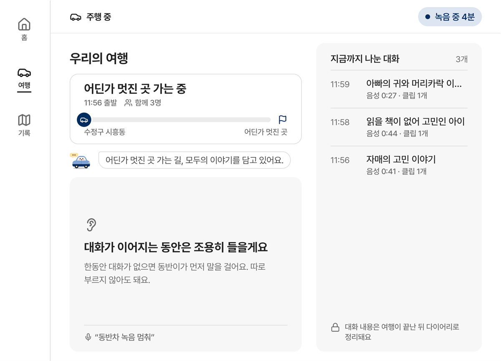 |

## ③ 조용할 때만 건네는 질문

대화가 이어지는 동안에는 끼어들지 않습니다. 대화 내용이 아니라 말소리의 유무와 목적지까지 남은 시간으로 때를 봅니다.

1. 차 안이 오래 조용하면 소리 없이 화면으로만 "혹시 다들 자고 있나요?"를 묻습니다.
2. 반응이 없으면 그 여행에서는 먼저 묻지 않습니다.
3. "아니, 안 자"처럼 말로 답하면 여행지와 동행 관계에 맞는 가벼운 질문을 소리로 읽어 줍니다.

| 잠들었는지 확인 (Q01) | 대화 질문 (Q02) |
|---|---|
| 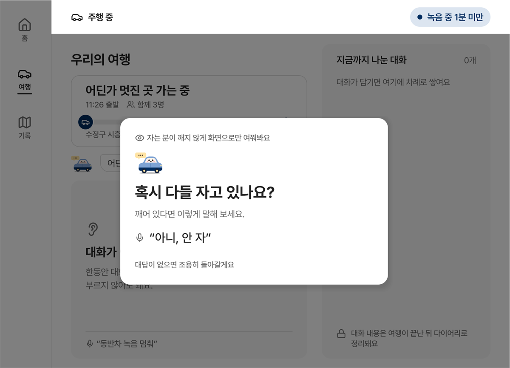 | 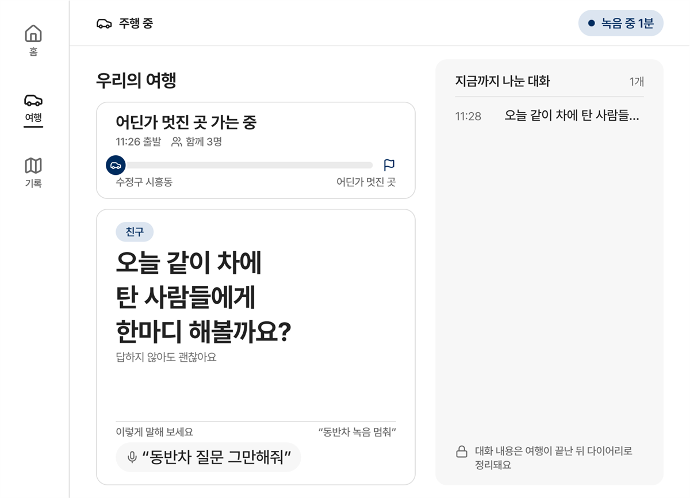 |

## ④ 운전자 안전: 기록은 정차했을 때만

Pleos [운전자 주의 분산 가이드라인](https://document.pleos.ai/docs/pleos-only/vehicle-app-planning-guide/driver-distraction-guideline)에 따라, 화면을 오래 봐야 하는 기능은 정차 중에만 엽니다.

- **다이어리, 기록 지도, 사진은 정차 중에만 열립니다.** 주행 중에 누르면 "이 기록은 안전하게 정차한 뒤 펼쳐볼 수 있어요"(P01)를 안내합니다.
- **정차하면 이어서 엽니다.** 기어가 P가 되면 "이제 펼쳐볼 수 있어요"(P02)로 원래 열려던 화면을 엽니다.
- **설정, 키 입력, 여행 끝내기도 정차 중에만 할 수 있습니다.**
- **주행 중 조작은 음성으로 합니다.** "동반차 녹음 멈춰", "동반차 질문 해줘", "동반차 질문 그만해줘"라고 말합니다.

| 주행 중 기록 열기 (P01) | 정차 후 이어서 열기 (P02) |
|---|---|
| 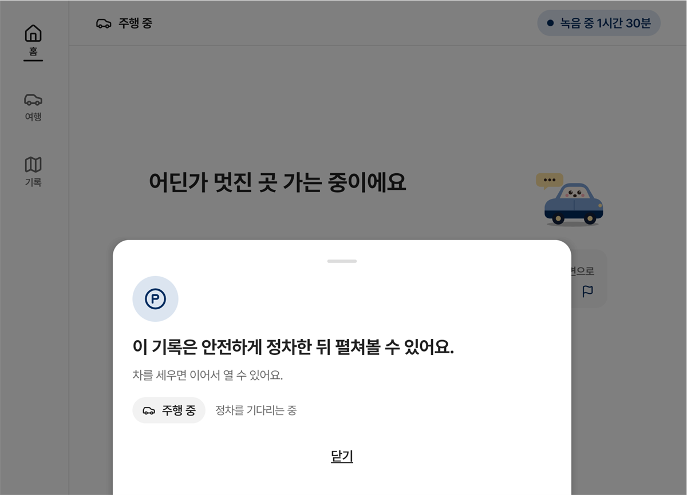 | 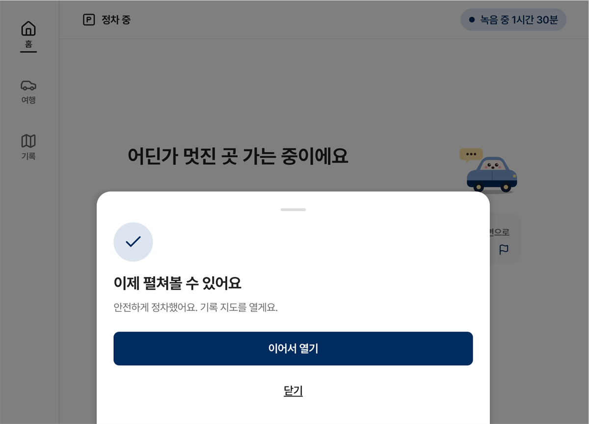 |

## ⑤ Gleo와 함께 쓰는 음성 명령

녹음 중에는 동반차가 마이크를 쓰므로 앱이 직접 명령을 알아듣습니다. 녹음을 멈춘 뒤에는 운전대 음성 버튼이나 "글레오"로 차량 음성 비서 Gleo를 부른 다음 "동반차 녹음 다시 시작해"라고 말합니다. 동반차는 앱 스키마(`assets/schema.json`)로 `PAUSE_TRIP_RECORDING`, `RESUME_TRIP_RECORDING`, `ASK_NEW_QUESTION` 기능을 Gleo에 등록합니다. Gleo 호출어와 기기 명령이 담긴 발화는 기록에서 뺍니다.

  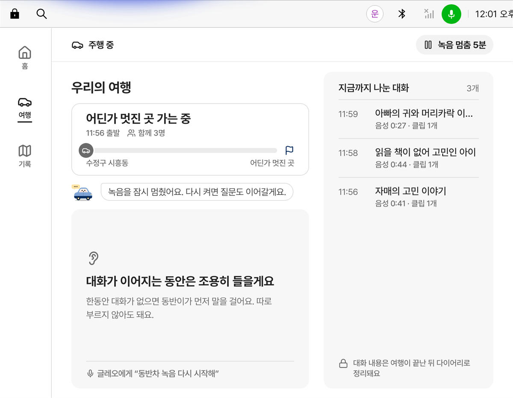

## ⑥ 도착과 다이어리 생성

차량 내비가 목적지 도착을 알리거나, 목적지 300m 안에서 기어가 P가 되면 여행을 스스로 마칩니다. 도착이 아니라면 **아직 여행 중이에요**로 되돌립니다. 주행 중에는 다이어리를 만들지 않고, 정차한 뒤 녹음 저장, 이야기 정리, 경로와 시간 정리, 다이어리 꾸미기 순서로 진행합니다.

| 도착 | 다이어리 만드는 중 | 완성 |
|---|---|---|
| 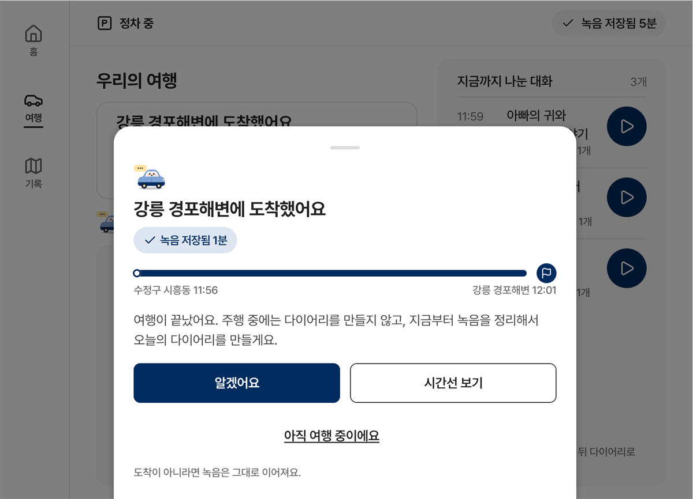 | 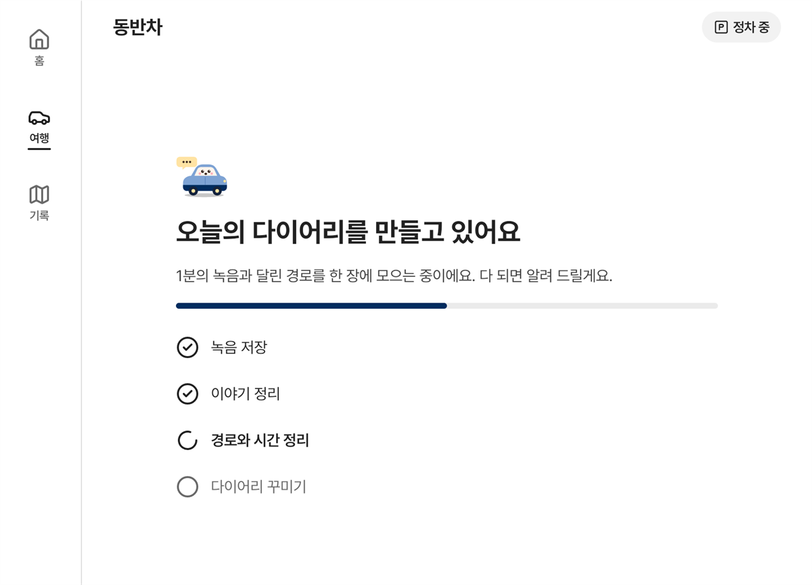 | 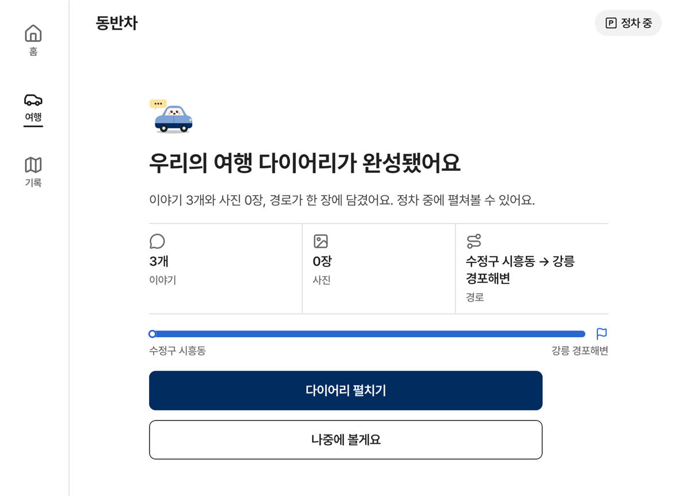 |

## ⑦ 기록 지도와 다이어리

지금까지의 여행은 지도 위에 기록마다 다른 색의 경로로 쌓입니다. 경로나 카드를 누르면 그날의 다이어리가 열립니다.

| 기록 지도 | 경로 고르기 |
|---|---|
| 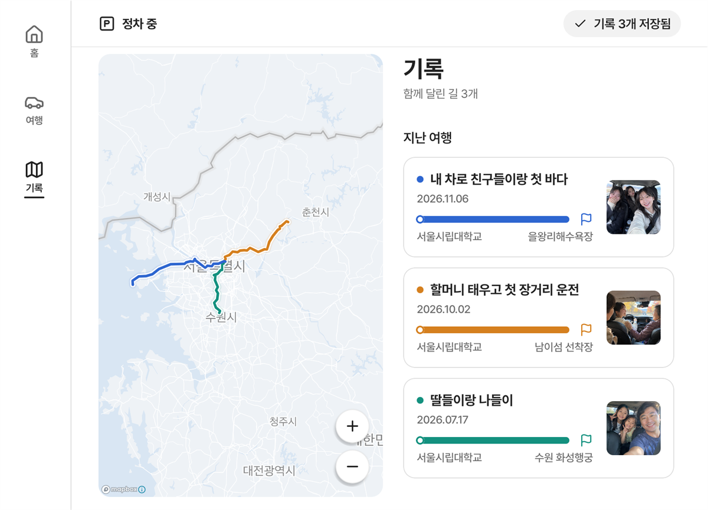 | 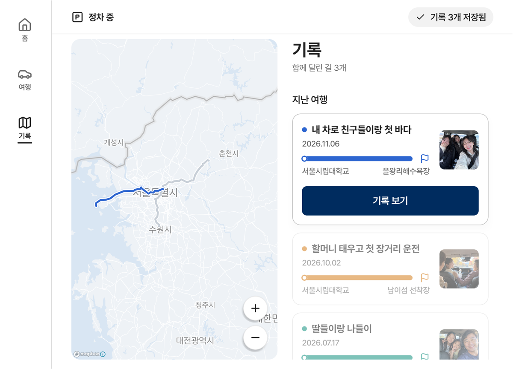 |

다이어리에는 날짜, 제목, 함께한 사람, 실제 주행 경로, 함께 달린 시간, 사진, 나눈 이야기가 한 장에 담깁니다.

- **나눈 이야기**: 이야기마다 제목, 태그, 음성 길이가 붙고 눌러서 다시 듣습니다. 이야기를 고르면 지도와 시간 띠에서 그 자리를 함께 보여 줍니다.
- **지도 핀**: 겹친 핀은 `+N` 배지로 묶이고, 누르면 확대됩니다.
- **사진**: 정방형 썸네일로 보여 줍니다. 더보기를 누르면 비율을 살린 masonry로 펼쳐지고, 누르면 크게 봅니다.

| 다이어리 | 이야기 고르기 |
|---|---|
| 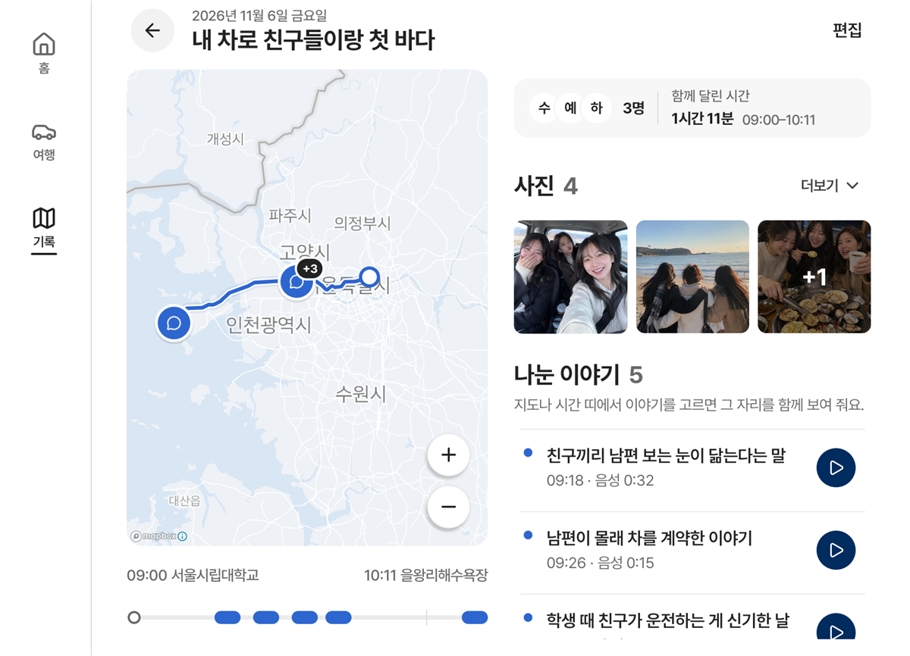 | 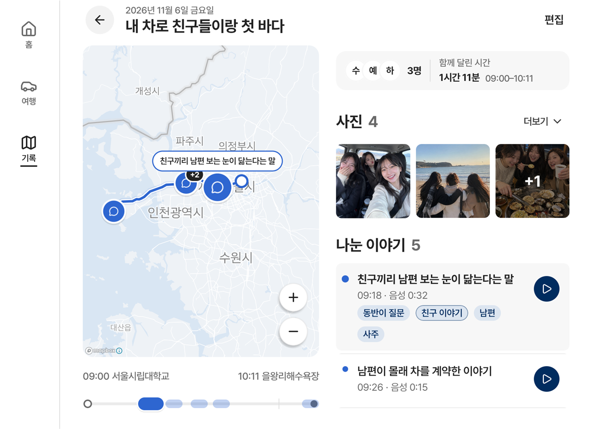 |

| 사진 펼치기 | 사진 크게 보기 |
|---|---|
| 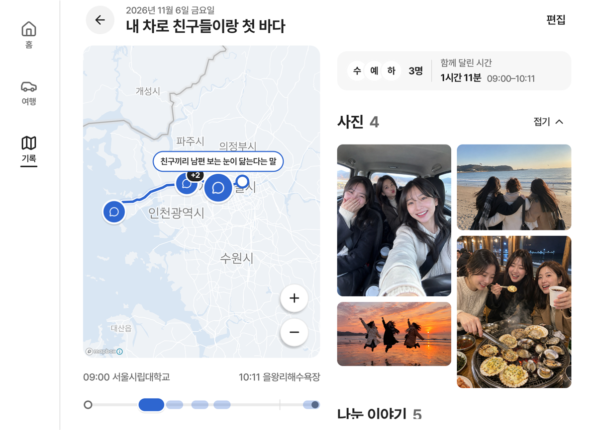 |  |

---

← 이전: [README](https://github.com/hyundai-app-devchallenge/drive-diary#목차) | 다음: [프로젝트 구조](structure.md) →
